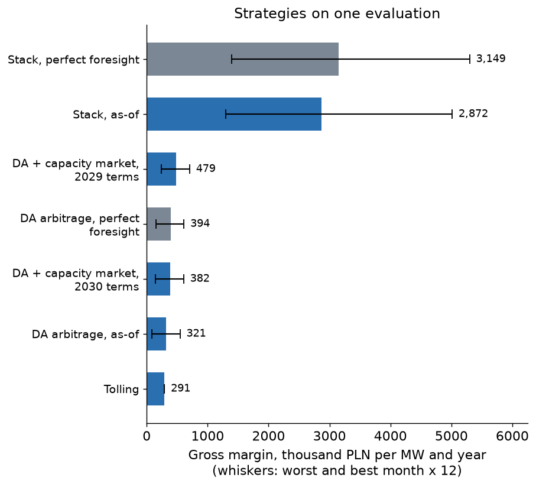
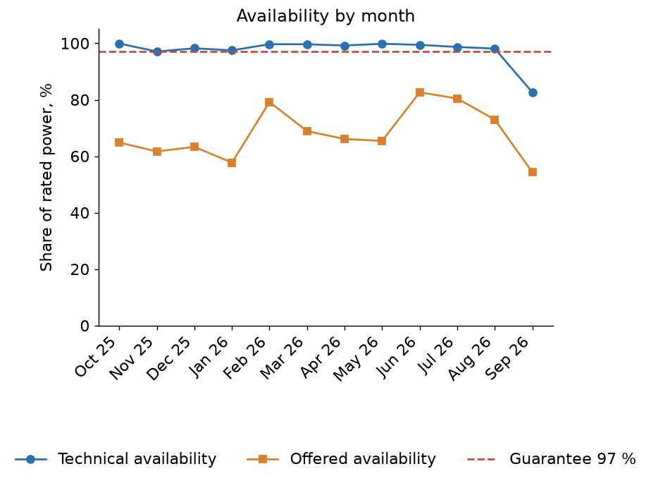
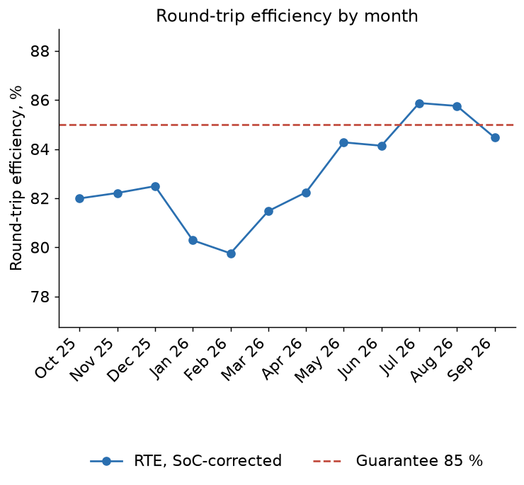
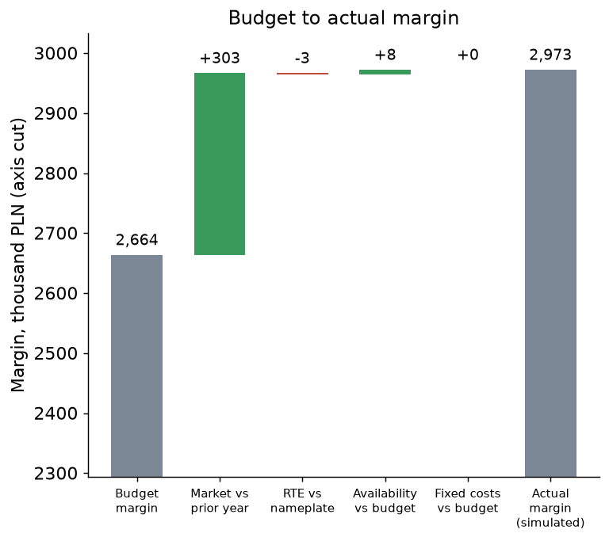
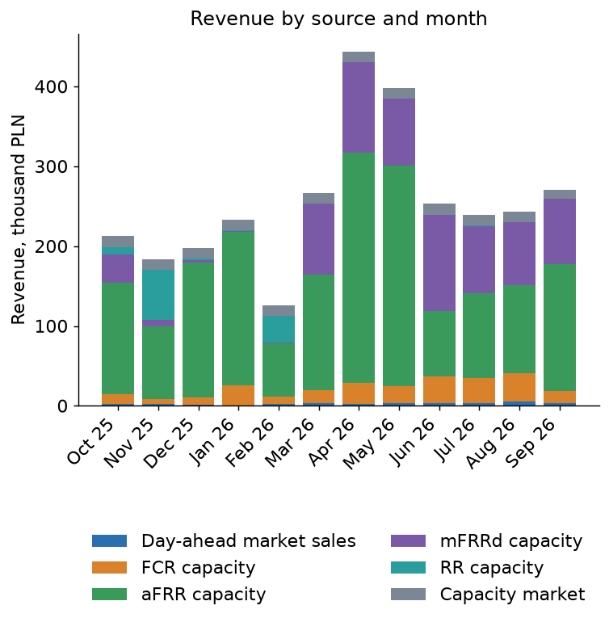

# bess-reporting-kit

[](https://github.com/kwwaleszczynski-del/bess-reporting-kit/actions/workflows/ci.yml)

**Example reports: https://kwwaleszczynski-del.github.io/bess-reporting-kit/**

How do you report a grid battery, and which way of selling its energy should it use? This library puts the answers of
the battery projects of this portfolio behind one input schema and one command line:

- a **technical report**: availability (including the physical availability declared to the market operator),
  round-trip efficiency, cycles, state of charge and health, auxiliary load, warranty and LTSA compliance;
- a **financial report**: revenue by source (day-ahead, balancing capacity, capacity market, tolling), costs, margin,
  budget variance and a budget-to-actual **bridge** whose steps add up exactly;
- a **common evaluation of sales strategies**: day-ahead arbitrage, a revenue stack, tolling and a capacity market
  contract, all planned with an explicit information set (as-of, nothing from the delivery day) and settled on the
  same prices at the same availability.

Reports come out as self-contained HTML pages and Excel workbooks. The library calls the existing projects instead of
copying them: [pse-opendata](https://github.com/kwwaleszczynski-del/pse-opendata) reads the PSE reports,
[res-asset-kpi](https://github.com/kwwaleszczynski-del/res-asset-kpi) holds the KPI definitions,
[bess-ops-warranty](https://github.com/kwwaleszczynski-del/bess-ops-warranty) does the technical analysis,
[pl-bess-revenue-stack](https://github.com/kwwaleszczynski-del/pl-bess-revenue-stack) the dispatch optimiser and the
capacity market terms, [bess-capacity-augmentation](https://github.com/kwwaleszczynski-del/bess-capacity-augmentation)
the ageing model.

> Everything here is working material, not an official statement, and not investment, trading or legal advice.
> Contract terms (toll, guarantees, fixed costs) are **illustrative placeholders**, capacity market terms are
> **to be verified** against the current regulations. The example money figures are a **simulation** on public
> prices, not the settlement of a real plant.

## Key results

All figures below are produced by `python -m bess_report example` and written to `results/summary.json`; the README is
rendered from them (`python -m bess_report readme`) and a test fails if it is not.

### Strategies on one evaluation

A 1.0 MW / 2.0 MWh battery, 365 delivery days
(2025-10-01 to 2026-09-30), PSE day-ahead and balancing capacity prices, gross margin
(revenue minus energy purchases minus a degradation allowance, before fixed costs) at an assumed availability of
97 % for every strategy.

| Strategy | Plan for day D may use | PLN/MW/year | Share of own ceiling | Worst month, PLN/MW | Best month, PLN/MW |
|---|---|---:|---:|---:|---:|
| DA arbitrage, perfect foresight | prices of the delivery day (ceiling, not tradeable) | 393 557 |  | 12 422 | 50 851 |
| DA arbitrage, as-of | day-ahead prices of the previous 7 days | 321 346 | 82 % | 7 072 | 45 514 |
| Stack, perfect foresight | prices of the delivery day, all products (ceiling, not tradeable) | 3 148 743 |  | 116 244 | 441 573 |
| Stack, as-of | day-ahead and capacity prices of the previous 7 days | 2 872 470 | 91 % | 107 716 | 417 629 |
| Tolling | contract terms | 291 000 |  | 24 250 | 24 250 |
| DA + capacity market, 2029 terms | day-ahead prices of the previous 7 days, contract terms | 478 858 |  | 20 198 | 58 640 |
| DA + capacity market, 2030 terms | day-ahead prices of the previous 7 days, contract terms | 381 744 |  | 12 106 | 50 547 |

- **The revenue stack earned 8.9 times the day-ahead arbitrage** as-of, and
  94 % of the revenue of the simulated year in the financial report came from balancing capacity payments.
  Both are for a price taker of one megawatt: balancing markets are small, so this does not scale to a fleet (see
  [pl-bess-saturation](https://github.com/kwwaleszczynski-del/pl-bess-saturation)).
- **Forecasting costs money, less in the stack.** With a plain seven-day average forecast the day-ahead
  strategy keeps 82 % of its perfect-foresight ceiling, the stack
  91 %.
- **A toll is a price for removing the market risk.** The placeholder toll of 300 000 PLN/MW/year
  has no monthly spread at all (scaled by the assumed availability it pays 291 000); the as-of day-ahead strategy earned 321 346 PLN/MW/year with a worst month of
  7 072 PLN/MW. A toll below the value of the strategy it replaces is the price of the risk.
- **The capacity market adds a fixed layer** on top of day-ahead arbitrage whose size depends on the auction and on the
  de-rating factor of batteries; the best of the two terms in the table adds 157 512 PLN/MW/year.



### Technical report: a battery of the Australian market on open data

Rangebank BESS (200 MW / 400 MWh), 12 months of AEMO public data,
assessed against the illustrative guarantees of the site file:

| KPI | Value | Guarantee or limit (illustrative) | Months meeting it |
|---|---:|---:|---:|
| Availability, time-weighted (declared) | 97.5 % | 97 % | 11 of 12 months |
| Offered availability (bids) | 68.1 % |  |  |
| RTE, mean of months, SoC-corrected | 82.9 % | 85 % | 2 of 12 months |
| Cycles per year (EFC) | 337.4 | 365 | 9 of 12 months |
| Technical outage, hours per year | 215.9 |  |  |
| Usable energy window trend, % per year | -0.70 |  |  |
| Modelled state of health after one year | 96.1 % |  |  |
| Modelled state of health after ten years | 82.5 % |  |  |

- Time-weighted declared availability was 97.5 %, with the lowest month at 82.7 %;
  offered availability, which also includes energy limits and capacity held back, was only
  68.1 %.
- The SoC-corrected round-trip efficiency at the SCADA point averaged 82.9 %, 2.1 percentage
  points below the illustrative guarantee. Auxiliaries behind the meter are not visible in market data, so on a
  real plant the figure including them would be lower.
- Market data cannot measure state of health. The state of health above is the ageing model projection for the observed
  duty at an assumed cell temperature of 25.0 degC; the energy window the operator reports is not a capacity measurement.




The same layout takes a long EMS or SCADA table. On the synthetic battery of bess-ops-warranty, whose truth is known:

| Synthetic EMS battery | Value |
|---|---:|
| Availability, LTSA formula | 97.9 % |
| RTE incl. auxiliaries | 86.1 % |
| Auxiliary energy, share of import | 5.4 % |
| Cycles per year (EFC) | 388.1 |
| Warranty violations found | 23 |
| Illustrative damages | 34 929 EUR |

### Financial report: a simulated year

The revenue stack planned as-of on PSE prices, scaled by the monthly availability and run at the monthly round-trip
efficiency of the technical report above (the ratios of an Australian battery applied to a Polish reference plant, to
show how technical results feed the money). The budget is a rule, not a forecast: the same strategy over the same calendar
months one year earlier, at nameplate efficiency and an availability of 97 %.

| Step | PLN |
|---|---:|
| Budget margin | 2 663 942 |
| Market vs prior year | +303 041 |
| RTE vs nameplate | -2 945 |
| Availability vs budget | +8 499 |
| Fixed costs vs budget | +0 |
| Actual margin (simulated) | 2 972 536 |



The margin differed from the budget by +11.6 %; the market step is a price effect of one year against the
year before, the efficiency and availability steps are the technical report priced. Revenue by source:

| Revenue line | PLN | Share |
|---|---:|---:|
| Day-ahead market sales | 31 574 | 1.0 % |
| FCR capacity | 243 661 | 7.9 % |
| aFRR capacity | 1 824 845 | 59.5 % |
| mFRRd capacity | 699 823 | 22.8 % |
| RR capacity | 109 123 | 3.6 % |
| Capacity market | 158 359 | 5.2 % |



## Install

```bash
pip install -e ".[all]"
```

The core needs only PyPI packages. The companion projects are not on PyPI, so the extras install them from their
public repositories: `ops` (technical analysis), `strategies` (optimiser and capacity market terms), `degradation`
(ageing model), `all` for every one.

## Use

```bash
python -m bess_report example --workers 4          # the bundled reports (results/, docs/)
python -m bess_report technical --nem-slice data/example/nem --duid RANGEB1 --site config/site.example.yaml
python -m bess_report technical --ems ems.parquet --mapping mapping.yaml --ems-site site.yaml --warranty w.yaml --ltsa l.yaml
python -m bess_report financial --settlement settlement.csv --budget budget.csv --site config/site.example.yaml
python -m bess_report strategies --site config/site.example.yaml --workers 4
python -m bess_report readme                       # README.md from README.template.md and results/
```

```python
from bess_report import schema, scenario, data
from bess_report.strategies import build_days

site = schema.load_site("config/site.example.yaml")
prices, capacity = data.load_slice("data/example")
runs = scenario.run_all(site, build_days(prices, capacity), workers=4)
table = scenario.compare(site, runs)
```

## Input schema

One YAML file for the site (`config/site.example.yaml`: battery, period, guarantees, fixed costs, toll, capacity market
auctions, budget availability) and two small money tables, one row per month and line:

| Table | Columns | Lines |
|---|---|---|
| `settlement.csv` | `month` (YYYY-MM), `line`, `value_pln` | revenue: `da_sales`, `fcr_capacity`, `afrr_capacity`, `mfrrd_capacity`, `rr_capacity`, `afrr_energy`, `imbalance`, `capacity_market`, `toll`, `other_revenue`; costs: `da_purchases`, `aux_energy`, `degradation`, `om`, `insurance`, `grid_fees`, `land_and_other`, `other_cost` |
| `budget.csv` | the same | the same |

The technical report reads either the long EMS table of bess-ops-warranty (`timestamp, device_id, signal, value`, with
its YAML mapping) or public AEMO tables. Margin is defined as

```math
\text{gross margin} = \text{revenue} - \text{day-ahead purchases} - \text{auxiliary energy} - \text{degradation allowance}
```

and the margin after fixed costs is the operating margin before depreciation and tax, not an accounting figure.

## The as-of assumption

A plan for delivery day D may use only what was published before D. The forecast of every quarter-hour energy price is the
mean of the same local time over the previous 7 days, the forecast of every balancing capacity price
the mean of the same local hour and product over the same days. `strategies.plan_inputs` makes that information set explicit
and a test checks that changing any price from day D onwards does not change the plan for D. The perfect-foresight rows are
ceilings that nobody can trade; each as-of row is compared with the ceiling of its own product set. Any better forecaster
can replace the baseline without changing the evaluation.

## What is not verified

- **Capacity market terms** (closing prices, de-rating factors) come from the pl-bess-revenue-stack project, which read them
  from the regulations and URE announcements; the rules change from auction to auction. To verify before any use. The
  obligation to deliver in stress periods is not modelled.
- **Balancing capacity** is assumed accepted in full at the clearing price (price taker); activation energy is not
  modelled; the duration requirements are the assumptions of the optimiser's documentation.
- **The toll and every fixed cost** are placeholders of the site file, not market quotes.
- **AEMO data** are public; the slice in `data/example/nem` holds the rows of one battery. Whether the reuse conditions of
  AEMO's copyright permission cover a redistributed slice is to be verified.
- **NEM availability** is what the operator declared with its bids, not a measurement; **RTE** is at the SCADA point.
- **State of health** is a model fitted on open cell data, not a measurement of any battery.
- The financial example combines Polish prices with the efficiency and availability ratios of an Australian battery: it
  demonstrates the link, it is not a statement about any real plant.
- The regulatory state changes often; check every rule against the current documents.

## Tests

```bash
pytest
```

The suite runs offline on the committed data: the as-of check, the bridge identity, the schema, the Excel and HTML
output, a check that no two texts overlap in any chart, and a check that this README is exactly what the template and
`results/summary.json` render to, with no number written by hand.

## Related projects

[bess-ops-warranty](https://github.com/kwwaleszczynski-del/bess-ops-warranty) ·
[pl-bess-revenue-stack](https://github.com/kwwaleszczynski-del/pl-bess-revenue-stack) ·
[pl-bess-paper-trading](https://github.com/kwwaleszczynski-del/pl-bess-paper-trading) ·
[bess-capacity-augmentation](https://github.com/kwwaleszczynski-del/bess-capacity-augmentation) ·
[bess-soc-soh-degradation](https://github.com/kwwaleszczynski-del/bess-soc-soh-degradation) ·
[pl-bess-saturation](https://github.com/kwwaleszczynski-del/pl-bess-saturation) ·
[bess-thermal-aux-load](https://github.com/kwwaleszczynski-del/bess-thermal-aux-load) ·
[pv-budget-bridge](https://github.com/kwwaleszczynski-del/pv-budget-bridge) ·
[res-asset-kpi](https://github.com/kwwaleszczynski-del/res-asset-kpi) ·
[pse-opendata](https://github.com/kwwaleszczynski-del/pse-opendata)

## License

MIT
