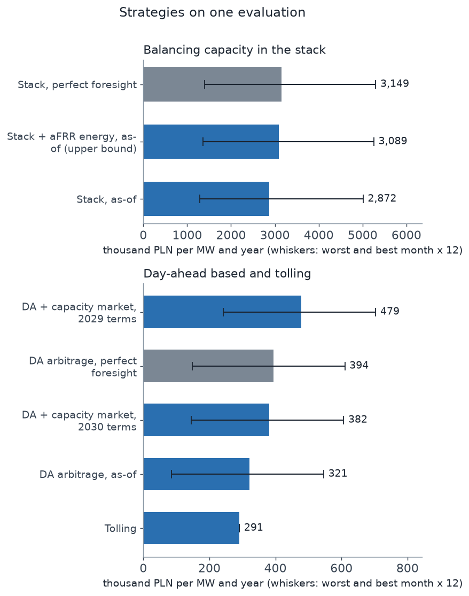
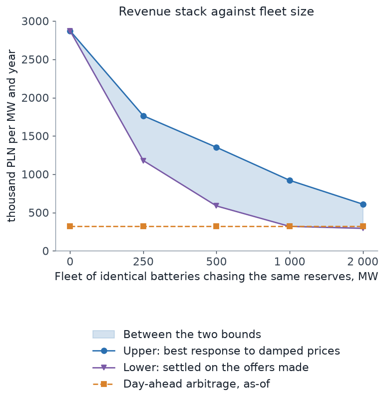
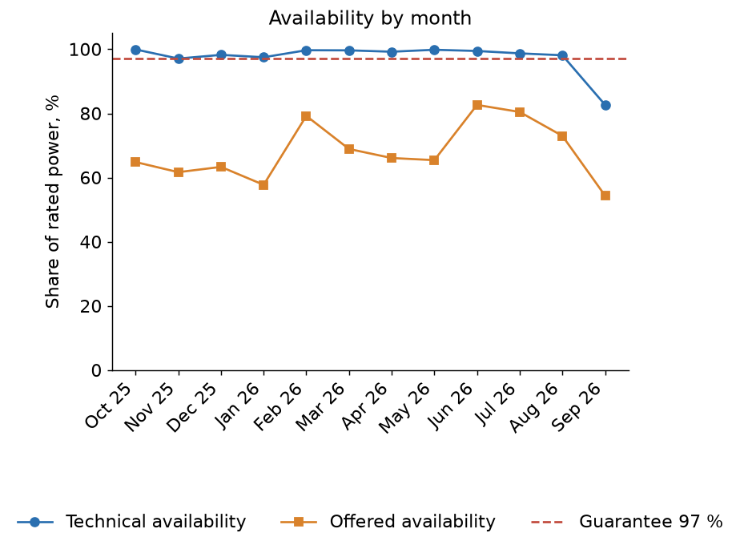
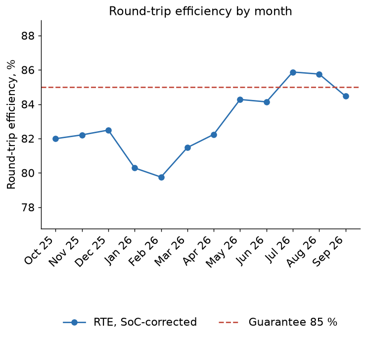
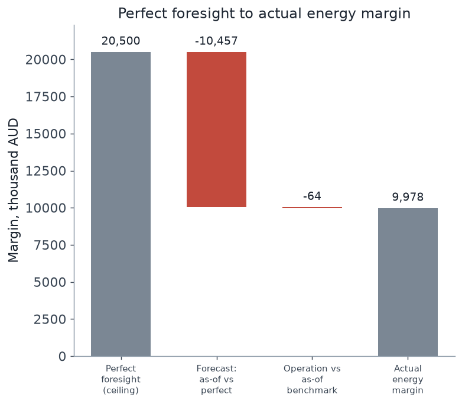
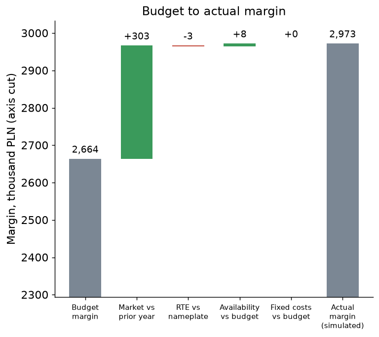
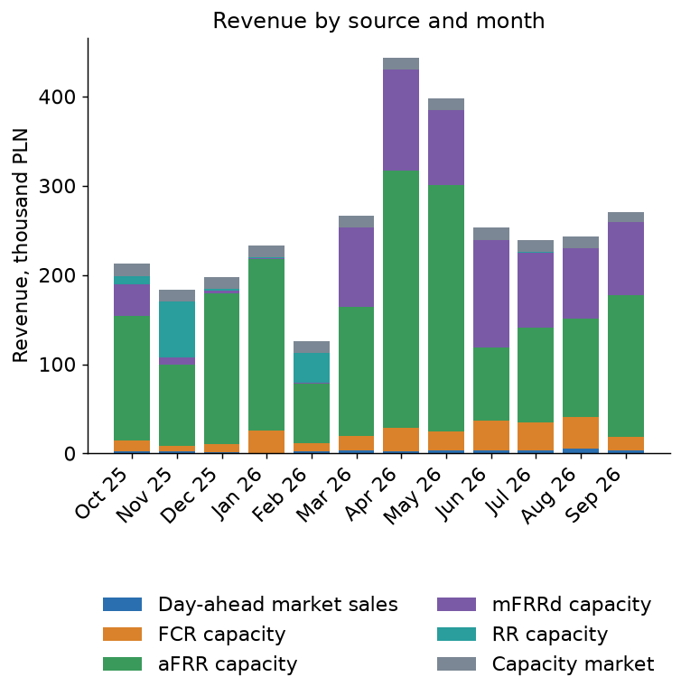

# bess-reporting-kit

[](https://github.com/kwwaleszczynski-del/bess-reporting-kit/actions/workflows/ci.yml)

**Example reports: https://kwwaleszczynski-del.github.io/bess-reporting-kit/**

How do you report a grid battery, and which way of selling its energy should it use? This library puts the answers of
the battery projects of this portfolio behind one input schema and one command line:

- a **technical report**: availability (including the physical availability declared to the market operator),
  round-trip efficiency, cycles, state of charge and health, auxiliary load, warranty and LTSA compliance;
- a **financial report**: revenue by source (day-ahead, balancing capacity, capacity market, tolling), costs, margin,
  budget variance and a budget-to-actual **bridge** whose steps add up exactly;
- a **common evaluation of sales strategies**: day-ahead arbitrage, a revenue stack, tolling and a capacity market
  contract, all planned with an explicit information set (as-of, nothing from the delivery day) and settled on the
  same prices at the same availability.

Reports come out as self-contained HTML pages and Excel workbooks. The library calls the existing projects instead of
copying them: [pse-opendata](https://github.com/kwwaleszczynski-del/pse-opendata) reads the PSE reports,
[res-asset-kpi](https://github.com/kwwaleszczynski-del/res-asset-kpi) holds the KPI definitions,
[bess-ops-warranty](https://github.com/kwwaleszczynski-del/bess-ops-warranty) does the technical analysis,
[pl-bess-revenue-stack](https://github.com/kwwaleszczynski-del/pl-bess-revenue-stack) the dispatch optimiser and the
capacity market terms, [bess-capacity-augmentation](https://github.com/kwwaleszczynski-del/bess-capacity-augmentation)
the ageing model.

> Everything here is working material, not an official statement, and not investment, trading or legal advice.
> Contract terms (toll, guarantees, fixed costs) are **illustrative placeholders**, capacity market terms are
> **to be verified** against the current regulations. The example money figures are a **simulation** on public
> prices, not the settlement of a real plant.

## Key results

All figures below are produced by `python -m bess_report example` and written to `results/summary.json`; the README is
rendered from them (`python -m bess_report readme`) and a test fails if it is not.

### Strategies on one evaluation

A {{assumptions.battery.power_mw|num1}} MW / {{assumptions.battery.energy_mwh|num1}} MWh battery, {{strategy_meta.days|int}} delivery days
({{strategy_meta.first_day}} to {{strategy_meta.last_day}}), PSE day-ahead and balancing capacity prices, gross margin
(revenue minus energy purchases minus a degradation allowance, before fixed costs) at an assumed availability of
{{strategy_meta.availability|pct0}} for every strategy.

{{table:strategies}}

- **What the stack is, in physical terms.** The as-of plan offers on average {{stack_profile.mean_up_mw|num2}} MW upward and
  {{stack_profile.mean_down_mw|num2}} MW downward in every hour of the year from a {{assumptions.battery.power_mw|num1}} MW battery, and arbitrages only
  {{stack_profile.arbitrage_cycles_per_day|num2}} cycles a day ({{stack_profile.arbitrage_mwh_per_year|num1}} MWh a year): "sell all the balancing capacity, always".
  Its share of the ceiling therefore says mostly that capacity prices persist from week to week, not that the forecast is
  skilful, and it is the result of a price taker of one megawatt (balancing markets are small; see the fleet model below).
  {{derived.capacity_lines_share|pct0}} of the revenue of the simulated year in the financial report came from balancing capacity payments.
- **Forecasting costs money, less in the stack.** With a plain {{assumptions.lookback_days|int}}-day average forecast the day-ahead
  strategy keeps {{strategies.da_asof.share_of_ceiling|pct0}} of its perfect-foresight ceiling, the stack
  {{strategies.stack_asof.share_of_ceiling|pct0}}.
- **aFRR activation energy is shown as an upper bound, not as a strategy.** Priced ex post with pro-rata activation of the
  capacity bought (the variant of pl-bess-revenue-stack, net of buying the energy back and of the degradation allowance),
  it would add up to {{derived.act_uplift|pct}}, but the plan does not know about it and neither the state of charge nor
  the cycle limit is enforced: it asks for {{afrr_activation.up_mwh_per_year|int}} MWh a year upward and
  {{afrr_activation.down_mwh_per_year|int}} MWh downward, against {{afrr_activation.arbitrage_mwh_per_year|int}} MWh of arbitrage, and on
  {{afrr_activation.days_net_above_reserve|int}} of {{afrr_activation.days|int}} days the net activated energy exceeds the state-of-charge
  reserve of {{afrr_activation.reserve_mwh|num2}} MWh. It has no perfect-foresight twin, so it has no share of a ceiling.
- **A toll is a price for removing the market risk.** The placeholder toll of {{assumptions.toll.pln_per_mw_year|pln}} PLN/MW/year
  has no monthly spread at all (scaled by the assumed availability it pays {{strategies.toll.pln_per_mw_year|pln}}); the as-of day-ahead strategy earned {{strategies.da_asof.pln_per_mw_year|pln}} PLN/MW/year with a worst month of
  {{strategies.da_asof.month_worst_pln_per_mw|pln}} PLN/MW. A toll below the value of the strategy it replaces is the price of the risk.
- **The capacity market adds a fixed layer** on top of day-ahead arbitrage whose size depends on the auction and on the
  de-rating factor of batteries; the best of the terms in the table adds {{derived.cm_best_extra|pln}} PLN/MW/year.



### How much the forecast matters

Both as-of strategies with a shorter or longer average as the forecast (the default is the row used everywhere
else; every length is planned on the same days and compared with the same ceiling):

{{table:sensitivity}}

A better forecaster can replace the baseline without changing the evaluation; the table is the room it has to work in.

### When the market fills up

The stack is a price taker's result: one megawatt among the demand the system operator buys per product. Flooding the
offer stacks PSE publishes with a fleet of identical batteries (the model of
[pl-bess-revenue-stack](https://github.com/kwwaleszczynski-del/pl-bess-revenue-stack), run on the same
{{strategy_meta.days|int}} days, perfect foresight, pro-rata acceptance) shows how much of the lone battery's margin is kept. The
iteration of prices and schedules is a damped best response, not a fixed point, so there is a lower and an upper bound: the revenue as
the model reports it (the best response to the prices the damped average implies, an upper bound) and the same last
schedule settled on the market its own offers create (a lower bound, since the batteries are identical). The as-of
stack is scaled by the share kept, which assumes the as-of plan loses the same share; day-ahead prices are not moved.

{{table:saturation}}

- At a fleet of {{derived.sat_mid_mw|int}} MW a battery keeps between {{derived.sat_mid_settled|pct0}} and {{derived.sat_mid_best|pct0}} of the lone
  battery's margin, at {{derived.sat_large_mw|int}} MW between {{derived.sat_large_settled|pct0}} and {{derived.sat_large_best|pct0}}.
- Against day-ahead arbitrage the scaled stack falls level at a fleet of {{saturation.breakeven_settled_mw|int}} MW on the lower
  bound and at {{saturation.breakeven_best_response_mw|int}} MW on the upper bound ("n/a": not reached within the fleet sizes run).
  At the largest fleet it earns between {{derived.sat_large_stack_settled|pln}} and {{derived.sat_large_stack_best|pln}} PLN/MW/year,
  against {{strategies.da_asof.pln_per_mw_year|pln}} for day-ahead arbitrage. The lone-battery table overstates what a stack is
  worth at scale.
- The model is optimistic in other ways too (existing offers do not move, demand does not change). After
  {{saturation.iterations|int}} rounds the schedules were still moving by {{derived.sat_mid_change|num2}} MW per hour and product on average at the middle
  fleet and {{derived.sat_large_change|num2}} MW at the largest, so no row is fully settled.



### Technical report: a battery of the Australian market on open data

{{technical_nem.name}} ({{technical_nem.mw|int}} MW / {{technical_nem.mwh|int}} MWh), {{technical_nem.months|int}} months of AEMO public data,
assessed against the illustrative guarantees of the site file:

{{table:nem}}

- Time-weighted declared availability was {{technical_nem.availability|pct}}, with the lowest month at {{technical_nem.availability_min_month|pct}};
  offered availability, which also includes energy limits and capacity held back, was only
  {{technical_nem.availability_offered|pct}}.
- Cycles are counted against the registered energy; the energy window the operator reports as stored is
  {{technical_nem.usable_window_mwh|num1}} MWh, so against it the battery made {{technical_nem.efc_per_year_usable|num1}} cycles a year.
- The SoC-corrected round-trip efficiency at the SCADA point averaged {{technical_nem.rte|pct}}, {{derived.rte_gap_pp|num1}} percentage
  points below the illustrative guarantee. Auxiliaries behind the meter are not visible in market data, so on a
  real plant the figure including them would be lower.
- Market data cannot measure state of health. The state of health above is the ageing model projection for the observed
  duty at an assumed cell temperature of {{technical_nem.soh_temp_c|num1}} degC; the energy window the operator reports is not a capacity measurement.




The same layout takes a long EMS or SCADA table. On the synthetic battery of bess-ops-warranty, whose truth is known:

{{table:ems}}

### Trading report: what the battery earned against what it could have

For the same battery, the metered power times the regional reference price of every {{nem_trading.interval_min|int}}-minute interval gives the actual
energy margin. Benchmarks run on the same prices and days, with the optimiser of pl-bess-revenue-stack and limits taken
from the battery's own data: its registered power, the energy window it really uses
({{nem_trading.usable_window_mwh|num1}} MWh against {{nem_trading.registered_mwh|int}} MWh registered), its measured round-trip efficiency and a daily throughput
limit of {{nem_trading.max_cycles_per_day|num2}} cycles, the most it ever made, so every day it operated is feasible for the benchmark and
perfect foresight is a true ceiling. One benchmark knows the prices of the day; the other plans from the
{{assumptions.lookback_days|int}}-day average. Frequency control revenue and contracts are not in this energy-only view.

{{table:trading}}

- The battery's energy margin was {{nem_trading.capture_vs_asof|pct0}} of the as-of benchmark and {{nem_trading.capture_vs_perfect|pct0}} of the
  perfect-foresight ceiling, {{nem_trading.actual_per_mw_year|pln}} AUD per MW and year, over {{nem_trading.days|int}} complete days.
- The as-of step shows the cost of forecasting on this market; the last step is what the energy benchmark does not know
  (frequency control, availability, the operator's own forecast), not a verdict on the operator.



### Financial report: a simulated year

The revenue stack planned as-of on PSE prices, scaled by the monthly availability and run at the monthly round-trip
efficiency of the technical report above (the ratios of an Australian battery applied to a Polish reference plant, to
show how technical results feed the money). The budget is a rule, not a forecast: the same strategy over the same calendar
months one year earlier, at nameplate efficiency and an availability of {{assumptions.budget.availability|pct0}}.

{{table:bridge}}



The margin differed from the budget by {{derived.bridge_change_pct|spct}}; the market step is a price effect of one year against the
year before, the efficiency and availability steps are the technical report priced. Revenue by source:

{{table:mix}}



## Install

```bash
pip install -e ".[all]"
```

The core needs only PyPI packages. The companion projects are not on PyPI, so the extras install them from their
public repositories: `ops` (technical analysis), `strategies` (optimiser and capacity market terms), `degradation`
(ageing model), `all` for every one.

## Use

```bash
python -m bess_report example --workers 4          # the bundled reports (results/, docs/)
python -m bess_report technical --nem-slice data/example/nem --duid RANGEB1 --site config/site.example.yaml
python -m bess_report technical --ems ems.parquet --mapping mapping.yaml --ems-site site.yaml --warranty w.yaml --ltsa l.yaml
python -m bess_report financial --settlement settlement.csv --budget budget.csv --site config/site.example.yaml
python -m bess_report strategies --site config/site.example.yaml --workers 4
python -m bess_report readme                       # README.md from README.template.md and results/
```

```python
from bess_report import schema, scenario, data
from bess_report.strategies import build_days

site = schema.load_site("config/site.example.yaml")
prices, capacity = data.load_slice("data/example")
runs = scenario.run_all(site, build_days(prices, capacity), workers=4)
table = scenario.compare(site, runs)
```

## Input schema

One YAML file for the site (`config/site.example.yaml`: battery, period, guarantees, fixed costs, toll, capacity market
auctions, budget availability) and small money tables, one row per month and line:

| Table | Columns | Lines |
|---|---|---|
| `settlement.csv` | `month` (YYYY-MM), `line`, `value_pln` | revenue: `da_sales`, `fcr_capacity`, `afrr_capacity`, `mfrrd_capacity`, `rr_capacity`, `afrr_energy`, `imbalance`, `capacity_market`, `toll`, `other_revenue`; costs: `da_purchases`, `aux_energy`, `degradation`, `om`, `insurance`, `grid_fees`, `land_and_other`, `other_cost` |
| `budget.csv` | the same | the same |

The technical report reads either the long EMS table of bess-ops-warranty (`timestamp, device_id, signal, value`, with
its YAML mapping) or public AEMO tables. Margin is defined as

```math
\text{gross margin} = \text{revenue} - \text{day-ahead purchases} - \text{auxiliary energy} - \text{degradation allowance}
```

and the margin after fixed costs is the operating margin before depreciation and tax, not an accounting figure.

## The as-of assumption

A plan for delivery day D may use only what was published before D. The forecast of every energy price interval is the
mean of the same local time over the previous {{assumptions.lookback_days|int}} days, the forecast of every balancing capacity price
the mean of the same local hour and product over the same days. `strategies.plan_inputs` makes that information set explicit
and a test checks that changing any price from day D onwards does not change the plan for D. The perfect-foresight rows are
ceilings that nobody can trade; each as-of row is compared with the ceiling of its own product set. Any better forecaster
can replace the baseline without changing the evaluation.

## What is not verified

- **Capacity market terms** (closing prices, de-rating factors) come from the pl-bess-revenue-stack project, which read them
  from the regulations and URE announcements; the rules change from auction to auction. To verify before any use. The
  obligation to deliver in stress periods is not modelled.
- **Balancing capacity** is assumed accepted in full at the clearing price (price taker; see the fleet model for what a
  fleet does to that); activation energy is only the upper bound described above; the duration requirements are the
  assumptions of the optimiser's documentation.
- **The fleet model** is not a fixed point and gives a lower and an upper bound, not an equilibrium; the as-of scaling assumes the as-of plan
  loses the same share as the perfect plan.
- **The NEM trading benchmark** takes its limits from the battery's data, but it is an energy-only arbitrage plan: what a
  gap to it means (frequency control, availability, the operator's forecast) is not identified.
- **The toll and every fixed cost** are placeholders of the site file, not market quotes.
- **AEMO data** are public; the slice in `data/example/nem` holds the rows of one battery. Whether the reuse conditions of
  AEMO's copyright permission cover a redistributed slice is to be verified.
- **NEM availability** is what the operator declared with its bids, not a measurement; **RTE** is at the SCADA point.
- **State of health** is a model fitted on open cell data, not a measurement of any battery.
- The financial example combines Polish prices with the efficiency and availability ratios of an Australian battery: it
  demonstrates the link, it is not a statement about any real plant.
- The regulatory state changes often; check every rule against the current documents.

## Tests

```bash
pytest
```

The suite runs offline on the committed data: the as-of check, the bridge identity, the schema, the Excel and HTML
output, a check that no texts overlap in any chart, and a check that this README is exactly what the template and
`results/summary.json` render to, with no number written by hand, in digits or as a word.

## Related projects

[bess-ops-warranty](https://github.com/kwwaleszczynski-del/bess-ops-warranty) ·
[pl-bess-revenue-stack](https://github.com/kwwaleszczynski-del/pl-bess-revenue-stack) ·
[pl-bess-paper-trading](https://github.com/kwwaleszczynski-del/pl-bess-paper-trading) ·
[bess-capacity-augmentation](https://github.com/kwwaleszczynski-del/bess-capacity-augmentation) ·
[bess-soc-soh-degradation](https://github.com/kwwaleszczynski-del/bess-soc-soh-degradation) ·
[pl-bess-saturation](https://github.com/kwwaleszczynski-del/pl-bess-saturation) ·
[bess-thermal-aux-load](https://github.com/kwwaleszczynski-del/bess-thermal-aux-load) ·
[pv-budget-bridge](https://github.com/kwwaleszczynski-del/pv-budget-bridge) ·
[res-asset-kpi](https://github.com/kwwaleszczynski-del/res-asset-kpi) ·
[pse-opendata](https://github.com/kwwaleszczynski-del/pse-opendata)

## License

MIT
